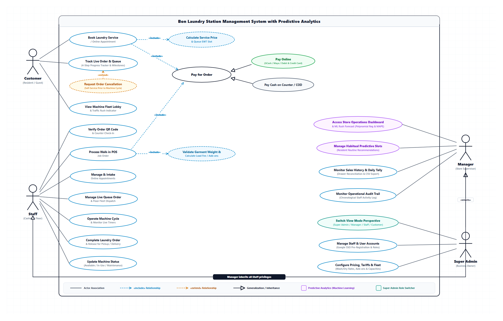

# CHAPTER 3: SYSTEM DESIGN AND METHODOLOGY
## 3.3 Use Case Modeling and Functional Specifications
### Bon Laundry Station Management System with Predictive Analytics (Urban Deca Homes Ortigas)

---

### 3.3.1 Overview of Use Case Modeling
Use case modeling serves as the behavioral foundation of the proposed **Bon Laundry Station Management System with Predictive Analytics**. It formally captures the functional requirements, operational interactions, and business services provided by the system from the direct perspective of its end-users. 

The diagram and its accompanying specifications adhere strictly to the **Object Management Group (OMG) Unified Modeling Language (UML 2.5)** standard and software engineering best practices:

1. **Explicit System Boundary**: The system boundary is clearly demarcated by a labeled rectangle representing the internal software scope (*"Bon Laundry Station Management System with Predictive Analytics"*). All human actors reside outside the boundary, while all functional goals (use cases) are contained within.
2. **Standard Actor Semantics**: Actors represent external roles that initiate or participate in system tasks. Individual human identities, specific job titles, and internal hardware are avoided. Human actors are rendered using standard stick-figure notation.
3. **Goal-Oriented Verb-Noun Phrasing**: Every use case oval represents an observable result of business value to an actor and is named using an active verb followed by a concise noun phrase (e.g., *Book Laundry Service*, *Process Walk-in POS Job Order*, *Access Store Operations Dashboard & ML Rush Forecast*).
4. **Association Communication Paths**: Solid, undirected lines indicate communication paths between an actor and a use case. Simple association lines do not possess arrowheads, confirming bidirectional interaction.
5. **Strict Dependency Stereotypes (`«include»` vs. `«extend»`)**:
   - The `«include»` dependency (dashed arrow pointing from base to included use case) models compulsory sub-tasks that are unconditionally executed.
   - The `«extend»` dependency (dashed arrow pointing from extending to base use case) represents optional or conditional behaviors activated only at explicit extension points.
6. **Role Generalization / Inheritance**: Generalization relationships (solid line with an open hollow triangle `──▷` pointing to the parent role) are applied across management roles ($\text{Super Admin} \xrightarrow{\text{inherits}} \text{Manager} \xrightarrow{\text{inherits}} \text{Staff}$), ensuring that managerial actors inherently possess operational floor capabilities without duplicating communication links.
7. **Architectural Scope & Bot Exclusion**: Third-party automated chat bots (e.g., Telegram bot) have been explicitly excluded from the system boundary. Operational automation is natively achieved via responsive mobile web interfaces, optical QR code validation, and direct transactional SMS alerts (PhilSMS), preventing external API failure points.

---

### 3.3.2 Actor Identification and Role Hierarchy

The proposed system identifies four primary human actors interacting within the operational environment of Bon Laundry Station:

#### Table 15. System Actors and Operational Roles

| Actor Name | Role Category | Operational Description | Associated Core Use Cases |
| :--- | :--- | :--- | :--- |
| **Customer** | Primary (Human) | Residential client of Urban Deca Homes Ortigas. Interacts via public web portal without mandatory account registration (guest model). | Book Laundry Service, Track Live Order & Queue, Request Order Cancellation, View Machine Lobby & Traffic, Settle Payment. |
| **Staff** | Primary (Human) | Front-desk cashier and laundry floor operator. Authenticates via Google Single Sign-On (SSO) or internal credentials. | Verify QR Code, Process POS Job Orders, Manage Online Appointments, Dispatch Queue, Operate Machines, Update Fleet Status. |
| **Manager** | Secondary (Supervisor) | Store supervisor with supervisory authority. **Inherits all Staff privileges** ($\text{Manager} \xrightarrow{\text{inherits}} \text{Staff}$). Oversees business reconciliation and ML insights. | Access Operations Dashboard & ML Rush Forecast, Manage Habitual Predictive Slots, Reconcile Sales History, Monitor Audit Trail. |
| **Super Admin** | Secondary (Executive) | Business owner and chief system administrator. **Inherits all Manager privileges** ($\text{Super Admin} \xrightarrow{\text{inherits}} \text{Manager} \xrightarrow{\text{inherits}} \text{Staff}$). Controls core configurations. | Switch View Mode Perspective, Manage Staff Accounts (Google SSO), Configure Pricing, Tariffs & Fleet Settings. |

---

### 3.3.3 System Use Case Diagram

**Figure 16. UML Use Case Diagram for Bon Laundry Station Management System with Predictive Analytics**

#### Architectural Narrative of the Subsystems:
* **Customer Subsystem (Self-Service Portal)**: Residents interact directly with *Book Laundry Service / Online Appointment*, *Track Live Order & Queue*, and *View Machine Fleet Lobby & Traffic Indicator*. The booking flow mandates (`«include»`) dynamic calculation of service fees and queue EWT slots, while order tracking allows an optional (`«extend»`) self-service cancellation before machine cycles commence.
* **Payment Processing Subsystem**: *Pay for Order* is modeled as an abstract base transaction interface included by both online bookings and walk-in counter POS orders. It is specialized via UML generalization into *Pay Online (GCash / Maya / Card)* and *Pay Cash on Counter / COD*.
* **Staff Floor Operations Subsystem**: Staff members execute seven dedicated floor use cases ranging from optical QR code verification ($<15$ seconds counter intake) and walk-in POS job order processing, to machine timer dispatching, fleet status updating, and final order handover.
* **Supervisory Predictive Analytics Subsystem**: The Store Manager accesses operational dashboards embedded with 2nd-Degree Polynomial Regression demand forecasting (evaluated via Mean Absolute Percentage Error, MAPE), manages habitual predictive slots for recurrent resident routines, reconciles daily drawer tallies, and audits chronological staff logs.
* **System Administration Subsystem**: The Super Admin leverages executive utilities including the dynamic View Mode Perspective Switcher (enabling instant viewport transitions between Admin, Manager, Staff, and Customer for live quality assurance), staff Google SSO pre-registration, and system tariff configurations.

---

### 3.3.4 Formal Use Case Specifications

#### USE CASE SPECIFICATION: UC-01 — BOOK LAUNDRY SERVICE / ONLINE APPOINTMENT
| Attribute | Specification Details |
| :--- | :--- |
| **Primary Actor(s)** | Customer (Resident of Urban Deca Homes Ortigas) |
| **Description** | Allows residential clients to schedule self-service or full-service laundry appointments online, specifying per-load service tiers, detergent and softener preferences per machine, and delivery mode. |
| **Preconditions** | Resident accesses the Bon Laundry Station customer web portal via web browser; system pricing rules are active. |
| **Postconditions** | A pending laundry job order is created in the database with a unique alphanumeric reference code and optical QR code; Estimated Waiting Time (EWT) is projected. |
| **Trigger** | Resident navigates to the booking section of the customer portal and clicks 'Book Appointment'. |
| **Main Flow of Events** | 1. System displays service booking form with load customization options. 2. Customer specifies contact details (Name, Condo Building/Unit, Mobile Phone Number). 3. Customer selects service type (Wash & Dry, Wash Only, Dry Only) and sets load count. 4. Customer customizes detergent and fabric softener selections per allocated machine load. 5. Customer selects service fulfillment method (Doorstep Condo Pickup & Delivery or Self Drop-off at Station). 6. System invokes `«include»` Calculate Service Price & Queue EWT Slot (UC-04). 7. System invokes `«include»` Pay for Order (UC-05). 8. Customer submits the booking request. 9. System saves appointment record, issues Order Reference Code and QR code, and sends confirmation SMS. |
| **Alternative / Exception Flows** | 4a. Machine Fleet at maximum operational capacity: &nbsp;&nbsp;&nbsp;&nbsp;1. System alerts customer of high queue density and displays projected delay. &nbsp;&nbsp;&nbsp;&nbsp;2. Customer accepts projected slot or chooses alternate schedule. 8a. Missing required contact or unit information: &nbsp;&nbsp;&nbsp;&nbsp;1. System highlights invalid input fields and halts submission until resolved. |
| **Stereotype Relationships** | `«include»` UC-04: Calculate Service Price & Queue EWT Slot `«include»` UC-05: Pay for Order |

---

#### USE CASE SPECIFICATION: UC-02 — TRACK LIVE ORDER & QUEUE MILESTONE
| Attribute | Specification Details |
| :--- | :--- |
| **Primary Actor(s)** | Customer (Resident) |
| **Description** | Enables clients to monitor the real-time operational status and queue progression of their laundry garments through a synchronized four-step progress tracker. |
| **Preconditions** | Order reference code exists in the database. |
| **Postconditions** | Customer views current milestone (Order Received, In Queue, In Progress [Washing/Drying], Ready for Pickup/Delivery). |
| **Trigger** | Customer inputs order reference code in portal search or scans ticket QR code. |
| **Main Flow of Events** | 1. Customer enters order tracking code or clicks tracking link from SMS. 2. System retrieves order status, assigned machine units, and countdown timers. 3. System renders active milestone stepper highlighting current laundry stage. 4. System displays projected ready time and floor operator notes. |
| **Alternative / Exception Flows** | 2a. Order reference code not found: &nbsp;&nbsp;&nbsp;&nbsp;1. System displays 'Invalid Reference Code' error message and prompts retry. 3a. Customer elects to cancel pending order: &nbsp;&nbsp;&nbsp;&nbsp;1. System invokes `«extend»` Request Order Cancellation (UC-03) if processing has not started. |
| **Stereotype Relationships** | `«extend»` UC-03: Request Order Cancellation (Extension Point: Order not yet in wash cycle) |

---

#### USE CASE SPECIFICATION: UC-03 — REQUEST ORDER CANCELLATION
| Attribute | Specification Details |
| :--- | :--- |
| **Primary Actor(s)** | Customer (Resident) |
| **Description** | Permits customers to cancel a previously scheduled laundry appointment prior to physical intake or machine loading. |
| **Preconditions** | Order exists in 'Pending' or 'In Queue' status; machine washing cycle has not been initiated. |
| **Postconditions** | Order status is transitioned to 'Cancelled'; allocated machine queue slot is released; cancellation audit event logged. |
| **Trigger** | Customer clicks 'Cancel Order' button from the live order tracking viewport. |
| **Main Flow of Events** | 1. Customer clicks 'Cancel Order' on tracking screen. 2. System verifies that garments have not entered active wash cycle. 3. System prompts customer to confirm cancellation reason. 4. Customer confirms cancellation request. 5. System updates order state to 'Cancelled', updates queue, and notifies customer via SMS. |
| **Alternative / Exception Flows** | 2a. Garments already loaded in washer or in-progress: &nbsp;&nbsp;&nbsp;&nbsp;1. System disables cancellation and displays alert: 'Cannot cancel order currently in processing. Please contact staff directly.' |
| **Stereotype Relationships** | Extends UC-02: Track Live Order & Queue |

---

#### USE CASE SPECIFICATION: UC-04 — CALCULATE SERVICE PRICE & QUEUE EWT SLOT
| Attribute | Specification Details |
| :--- | :--- |
| **Primary Actor(s)** | System (Automated Functional Service) |
| **Description** | Automatically calculates total billing amount based on load weight/quantity, premium detergent add-ons, and condo doorstep delivery surcharges, while projecting queue Estimated Waiting Time (EWT). |
| **Preconditions** | Pricing tariff matrix and live machine utilization metrics are loaded. |
| **Postconditions** | Itemized bill breakdown and EWT time slot are returned to the calling use case. |
| **Trigger** | Invoked unconditionally by Book Laundry Service (UC-01). |
| **Main Flow of Events** | 1. System inspects selected wash/dry tier and number of loads. 2. System queries active machine fleet to calculate current cycle completion times. 3. System adds add-on supply tariffs (detergent, fabric softener) and delivery fee. 4. System calculates cumulative Estimated Waiting Time (EWT) based on active queue backlog. 5. System returns total price and EWT to the customer booking form. |
| **Alternative / Exception Flows** | None (Compulsory mathematical routine). |
| **Stereotype Relationships** | Included by UC-01: Book Laundry Service / Online Appointment |

---

#### USE CASE SPECIFICATION: UC-05 — PAY FOR ORDER
| Attribute | Specification Details |
| :--- | :--- |
| **Primary Actor(s)** | Customer (Resident) / Staff (Cashier) |
| **Description** | Abstract generalized transaction use case that handles settlement of laundry service fees, specialized into digital online payment or cash on counter/COD. |
| **Preconditions** | Validated job order total has been calculated. |
| **Postconditions** | Payment status updated to 'Paid' or 'Pending Cash Collection'; receipt record generated. |
| **Trigger** | Customer checks out online or Staff closes job order at POS counter. |
| **Main Flow of Events** | 1. System presents payment options (Pay Online or Pay Cash). 2. User selects payment channel. 3. System delegates execution to specialized payment use case (UC-06 or UC-07). 4. System records transaction reference and marks order payment status. |
| **Alternative / Exception Flows** | 3a. Transaction declined or cancelled by payment gateway: &nbsp;&nbsp;&nbsp;&nbsp;1. System prompts user to retry or select cash on counter. |
| **Stereotype Relationships** | Generalizes into UC-06 (Pay Online) and UC-07 (Pay Cash) Included by UC-01 (Booking) and UC-09 (POS) |

---

#### USE CASE SPECIFICATION: UC-08 — VERIFY ORDER QR CODE & COUNTER CHECK-IN
| Attribute | Specification Details |
| :--- | :--- |
| **Primary Actor(s)** | Staff (Cashier / Front-Desk) |
| **Description** | Enables front-desk staff to rapidly verify arriving laundry bags against online booking records using optical QR scanning or alphanumeric order lookup in under 15 seconds. |
| **Preconditions** | Staff is authenticated in Staff Portal; customer presents QR ticket or booking code. |
| **Postconditions** | Order status transitions from 'Booked' to 'Received / Checked-In'; laundry bags tagged for floor dispatch. |
| **Trigger** | Staff scans customer QR code using integrated counter camera or enters code manually. |
| **Main Flow of Events** | 1. Staff activates counter scanner or enters 6-character order code. 2. System displays matched booking details, resident condo unit, and load configurations. 3. Staff inspects physical garment bags and confirms piece/weight count. 4. Staff confirms check-in. 5. System updates order state to 'Received' and queues job for machine allocation. |
| **Alternative / Exception Flows** | 2a. QR code unreadable or expired: &nbsp;&nbsp;&nbsp;&nbsp;1. Staff searches by customer phone number or resident name. 3a. Physical garment count exceeds booked load specifications: &nbsp;&nbsp;&nbsp;&nbsp;1. Staff updates load count and system recalculates balance. |
| **Stereotype Relationships** | Direct Association: Staff |

---

#### USE CASE SPECIFICATION: UC-09 — PROCESS WALK-IN POS JOB ORDER
| Attribute | Specification Details |
| :--- | :--- |
| **Primary Actor(s)** | Staff (Cashier) |
| **Description** | Facilitates rapid counter intake for walk-in residents who drop off laundry without prior online appointment. |
| **Preconditions** | Staff is logged into POS terminal. |
| **Postconditions** | Walk-in job order logged, laundry tagged, payment collected, and order queued for floor dispatch. |
| **Trigger** | Walk-in resident approaches counter with laundry. |
| **Main Flow of Events** | 1. Staff initiates 'New Walk-in Order' in POS module. 2. Staff inputs customer name, phone number, and condo unit. 3. Staff invokes `«include»` Validate Garment Weight & Calculate Load Fee. 4. Staff selects wash/dry package and customer detergent preferences. 5. Staff invokes `«include»` Pay for Order (UC-05) to collect cash or QR Ph payment. 6. System generates printed physical receipt and SMS job ticket. |
| **Alternative / Exception Flows** | 5a. Customer requests partial downpayment / COD: &nbsp;&nbsp;&nbsp;&nbsp;1. Staff records downpayment; balance flagged for settlement upon pickup. |
| **Stereotype Relationships** | `«include»` Validate Garment Weight `«include»` UC-05: Pay for Order |

---

#### USE CASE SPECIFICATION: UC-13 — ACCESS STORE OPERATIONS DASHBOARD & ML RUSH FORECAST
| Attribute | Specification Details |
| :--- | :--- |
| **Primary Actor(s)** | Manager (Store Supervisor) |
| **Description** | Provides store supervisors with operational oversight and machine learning predictions of hourly store rush, utilizing a 2nd-Degree Polynomial Regression model evaluated against Mean Absolute Percentage Error (MAPE). |
| **Preconditions** | Manager is authenticated with supervisory role credentials. |
| **Postconditions** | Manager reviews active shop metrics, queue throughput, and predictive peak hour demand curves. |
| **Trigger** | Manager navigates to the Operations Dashboard tab. |
| **Main Flow of Events** | 1. Manager accesses dashboard. 2. System aggregates real-time metrics: active orders, pending pickups, and idle machines. 3. System executes 2nd-degree polynomial regression pipeline on historical order telemetry. 4. System displays predicted rush hours (e.g., peak demand at 6:00 PM - 8:00 PM) alongside model MAPE validation score. 5. Manager adjusts staff floor schedules and machine pre-allocations accordingly. |
| **Alternative / Exception Flows** | 3a. Insufficient historical training records (<14 days): &nbsp;&nbsp;&nbsp;&nbsp;1. System displays baseline moving average while continuing automated model training. |
| **Stereotype Relationships** | Direct Association: Manager (Supervisory Role) |

---

#### USE CASE SPECIFICATION: UC-18 — SWITCH VIEW MODE PERSPECTIVE
| Attribute | Specification Details |
| :--- | :--- |
| **Primary Actor(s)** | Super Admin (Business Owner) |
| **Description** | Provides the business owner with a dynamic viewport switcher to transition seamlessly between Super Admin, Manager, Staff, and Customer interfaces without requiring repeated logins. |
| **Preconditions** | User is logged in with Super Admin executive permissions. |
| **Postconditions** | Application viewport adjusts to simulate the selected user perspective with corresponding UI elements and constraints. |
| **Trigger** | Super Admin selects a role perspective from the top navigation role switcher dropdown. |
| **Main Flow of Events** | 1. Super Admin opens Role Perspective dropdown menu. 2. Super Admin selects target role (e.g., 'Staff View' or 'Customer View'). 3. System temporarily adjusts session context and renders target interface without re-authenticating. 4. Super Admin inspects operational usability, verifies live staff queues, or tests customer booking flow. 5. Super Admin clicks 'Exit View Mode' to return to master Super Admin panel. |
| **Alternative / Exception Flows** | None (Internal diagnostic utility). |
| **Stereotype Relationships** | Direct Association: Super Admin |

---

#### USE CASE SPECIFICATION: UC-20 — CONFIGURE PRICING, TARIFFS & FLEET SETTINGS
| Attribute | Specification Details |
| :--- | :--- |
| **Primary Actor(s)** | Super Admin (Business Owner) |
| **Description** | Empowers the business owner to maintain master pricing structures, add-on costs, condo delivery surcharges, and machine fleet capacity specifications. |
| **Preconditions** | Super Admin authenticated with administrative privileges. |
| **Postconditions** | Master system tariffs and hardware parameters updated across all calculation engines. |
| **Trigger** | Super Admin navigates to 'System Settings' panel. |
| **Main Flow of Events** | 1. Super Admin accesses Pricing & Fleet Settings. 2. Super Admin updates base wash/dry tier pricing (e.g., 8kg Wash & Dry rate). 3. Super Admin updates detergent and fabric softener unit tariffs. 4. Super Admin adjusts condo doorstep pickup/delivery surcharges. 5. Super Admin saves updated parameters. 6. System validates inputs and broadcasts updated tariffs across POS and booking engines. |
| **Alternative / Exception Flows** | 2a. Invalid non-numeric or negative price entered: &nbsp;&nbsp;&nbsp;&nbsp;1. System flags error and prevents database update. |
| **Stereotype Relationships** | Direct Association: Super Admin |
